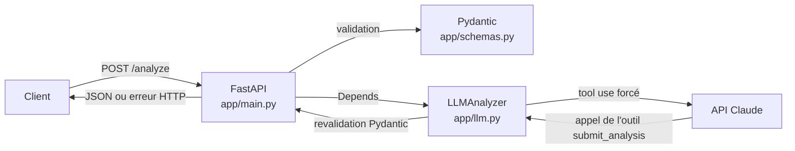

# Alternance Matcher API

[](https://github.com/rmekrant/alternance-matcher-api/actions/workflows/ci.yml)


API REST qui compare un CV à une offre d'alternance grâce à un LLM (Claude, d'Anthropic) et renvoie une analyse structurée : score de correspondance, compétences présentes et manquantes, résumé et conseils.

## Pourquoi ce projet

En recherche d'alternance, on adapte son CV à chaque offre. Cette API automatise la première étape : repérer ce que l'offre demande, ce que le CV montre déjà et ce qui manque. Le projet sert aussi de démonstration d'une intégration LLM propre : sortie structurée, validation, gestion des erreurs, tests sans appel payant, conteneurisation et intégration continue.

## Fonctionnalités

- `POST /analyze` : analyse un CV par rapport à une offre et renvoie un JSON validé.
- `GET /health` : vérifie que l'API est en ligne (utilisé par le healthcheck Docker).
- Documentation interactive générée automatiquement sur `/docs` (Swagger).
- Validation des entrées : textes trop courts, vides ou trop longs refusés avec un code 422.
- Erreurs du LLM traduites en codes HTTP explicites (502, 503, 504).

## Architecture



1. FastAPI reçoit la requête et Pydantic la valide. Si elle est invalide, l'API répond 422 sans appeler le LLM.
2. Le `LLMAnalyzer` est injecté par `Depends`, ce qui permet de le remplacer dans les tests.
3. Claude est obligé d'appeler l'outil `submit_analysis`, dont le schéma JSON est généré à partir du modèle Pydantic de la réponse.
4. La réponse du modèle est revalidée par Pydantic avant d'être renvoyée au client.

```
alternance-matcher-api/
├── app/
│   ├── main.py        # routes et gestionnaire d'erreurs
│   ├── schemas.py     # modèles Pydantic (requête et réponse)
│   ├── llm.py         # appel à Claude, prompt système, tool use
│   └── errors.py      # erreurs métier et leurs codes HTTP
├── tests/             # tests pytest avec un faux LLM
├── Dockerfile
├── .github/workflows/ci.yml
├── requirements.txt       # dépendances de production
└── requirements-dev.txt   # + dépendances de test
```

## Choix techniques

| Choix | Pourquoi |
|---|---|
| **FastAPI** | Validation et documentation OpenAPI automatiques à partir des types Python. |
| **Pydantic** | Contrat d'API explicite : contraintes de longueur sur les entrées, score borné entre 0 et 100 en sortie. |
| **Tool use forcé** (`tool_choice`) | Oblige le modèle à répondre dans le format JSON prévu, au lieu d'espérer qu'il respecte une consigne en texte libre. |
| **Schéma de l'outil généré depuis Pydantic** | Une seule source de vérité : modifier `AnalyzeResponse` met à jour l'outil automatiquement. |
| **Double validation** | Le modèle reçoit le schéma, puis sa réponse est revalidée. Une réponse hors format donne une 502 au lieu d'un plantage. |
| **Prompt système strict** | Interdit d'inventer des compétences absentes du CV et demande d'ignorer les instructions cachées dans les textes (injection de prompt). |
| **Injection de dépendance** (`Depends`) | Les tests remplacent le vrai LLM par un faux : 0 € de coût, tests rapides et reproductibles, pannes simulables. |
| **Codes HTTP précis** | 4xx quand la requête du client est en faute, 5xx quand c'est le service LLM. Les détails techniques restent dans les logs. |
| **`max_length` sur les textes** | Limite la taille des requêtes, donc le coût de chaque appel au LLM. |
| **Docker** | Image `python:3.11-slim`, utilisateur non-root, healthcheck sur `/health`. La clé API n'est jamais copiée dans l'image. |
| **GitHub Actions** | Tests et build Docker à chaque push, sans clé API grâce au faux LLM. |

## Lancer le projet

### Prérequis

- Python 3.11
- Une clé API Anthropic, à créer sur [console.anthropic.com](https://console.anthropic.com) (nécessaire uniquement pour les vrais appels, pas pour les tests)

### Installation (Windows PowerShell)

```powershell
git clone https://github.com/rmekrant/alternance-matcher-api.git
cd alternance-matcher-api
py -3.11 -m venv .venv
.venv\Scripts\Activate.ps1
pip install -r requirements-dev.txt
```

Sous macOS ou Linux, activez le venv avec `source .venv/bin/activate`.

### Configuration

Copiez `.env.example` en `.env` et renseignez votre clé :

```
ANTHROPIC_API_KEY=sk-ant-...
ANTHROPIC_MODEL=claude-haiku-5-5
```

Le fichier `.env` est ignoré par Git.

### Démarrer l'API

```powershell
uvicorn app.main:app --reload
```

L'API est disponible sur http://127.0.0.1:8000 et la documentation sur http://127.0.0.1:8000/docs.

### Avec Docker

```powershell
docker build -t alternance-matcher-api .
docker run --rm -p 8000:8000 --env-file .env alternance-matcher-api
```

### Lancer les tests

```powershell
pytest -v
```

Les tests n'appellent jamais Claude et ne nécessitent aucune clé API.

## Exemple

### Requête

```bash
curl -X POST http://127.0.0.1:8000/analyze \
  -H "Content-Type: application/json" \
  -d '{
    "job_offer": "Alternance développeur backend Python (24 mois). Missions : développer des API REST avec FastAPI, écrire des tests, conteneuriser les services avec Docker. Compétences : Python, FastAPI, SQL, Docker, Git.",
    "cv": "Étudiant ingénieur en 1re année à l EFREI Paris. Projets : pipeline ETL en Python vers PostgreSQL, API REST Spring Boot avec Docker. Outils : Git, GitHub, Power BI."
  }'
```

### Réponse (exemple, `200 OK`)

```json
{
  "score": 70,
  "matched_skills": ["Python", "SQL", "Docker", "Git"],
  "missing_skills": ["FastAPI", "Écriture de tests"],
  "summary": "Le candidat a une bonne base en Python, SQL et Docker grâce à ses projets. Il n'a pas encore d'expérience avec FastAPI ni de tests automatisés mentionnés.",
  "advice": [
    "Ajouter un projet d'API REST réalisé avec FastAPI.",
    "Mentionner les tests écrits dans les projets existants.",
    "Mettre en avant la conteneurisation Docker du projet Spring Boot."
  ]
}
```

Les valeurs exactes varient d'un appel à l'autre, car elles sont produites par le modèle.

### Codes d'erreur

| Code | Cas |
|---|---|
| `422` | Requête invalide : champ manquant, texte trop court (moins de 50 caractères) ou trop long |
| `502` | Erreur renvoyée par l'API Claude (clé invalide, crédits épuisés) ou réponse du modèle invalide |
| `503` | Clé API absente, ou API Claude saturée ou injoignable |
| `504` | L'API Claude n'a pas répondu à temps |

## Pistes d'amélioration

- Accepter des CV au format PDF en plus du texte brut.
- Ajouter une authentification et une limite de requêtes par client.
- Passer en asynchrone (`AsyncAnthropic`) pour mieux tenir la charge.
- Mettre en cache les analyses identiques pour réduire les coûts.

## Auteur

Projet réalisé par un étudiant ingénieur en ING1 à l'EFREI Paris, dans le cadre d'une recherche d'alternance.
